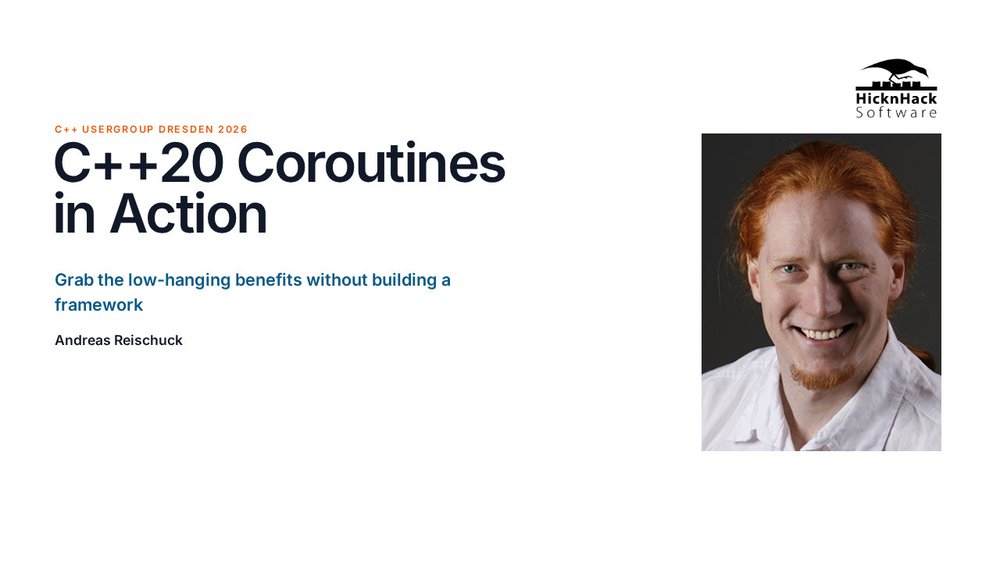

# C++20 Coroutines in Action slides

## Abstract

Are you intrigued by C++20 coroutines but unsure how to apply them in your projects? This talk demystifies coroutines by showcasing their practical benefits in two real-world scenarios, without diving into complex libraries or intricate details.

We'll explore:

1. Streamlining REST API interactions: Learn how coroutines can simplify asynchronous operations, eliminating callback hell and complex state management in a data acquisition application.
2. Enhancing multi-threaded workloads: Discover how coroutines can revolutionize your approach to Asynchronous Procedure Calls (APC) on Windows, leading to cleaner memory management and a more intuitive architecture.

Through these examples, you'll gain insights into:

- Identifying opportunities for coroutine usage in your existing codebase
- Practical implementation strategies for coroutines
- The tangible benefits of adopting coroutines, including improved code readability and maintainability

Walk away with the knowledge and confidence to leverage C++20 coroutines for immediate improvements in your projects. This talk is perfect for C++ developers looking to enhance their codebases with modern, efficient solutions.

- [Meeting C++ 2026 talk page](https://meetingcpp.com/2026/Talks/items/Simple_use_cases_for_Coroutines.html)
- [Desktop Duplicator source code with coroutines](https://github.com/arBmind/desktop-duplication-cpp/tree/feature/full_coroutine)

## [View Final Slides](https://arbmind.github.io/2026-using-coroutines-en/)

[](https://arbmind.github.io/2026-using-coroutines-en/)

[Logo credits](src/public/images/ATTRIBUTION.md)

The deck uses [Slidev](https://sli.dev/) and lives under `src/`.

## Start in VS Code

1. Reopen this folder in the devcontainer.
2. The container runs `npm install` and installs Chromium for CLI PDF export.
3. Start authoring with:

```sh
npm run dev
```

Open:

- `http://localhost:3030/` for the audience view
- `http://localhost:3030/presenter` for current slide, next slide, notes, timer, and controls
- `http://localhost:3030/overview` for the all-slides overview
- `http://localhost:3030/export` for the browser PDF exporter

Useful presenter shortcuts:

- `f` toggles fullscreen
- `space` or right arrow advances the next click or slide
- `o` opens the quick overview
- `g` opens slide jump

## Build outputs

```sh
npm run build          # static HTML in src/dist/
npm run build:pdf      # static HTML plus downloadable PDF in src/dist/
npm run export         # coroutines-slides.pdf
npm run export:clicks  # one PDF page per reveal step
npm run screenshots    # PNGs for every final reveal plus presenter view
```

Screenshots are written to `screenshots/`. The command starts its own
non-remote Slidev server and shuts it down afterward. To change its defaults:

```sh
SLIDEV_SCREENSHOT_DIR=/tmp/slides SLIDEV_SCREENSHOT_DELAY=1200 npm run screenshots
```

## Compile the teaching examples

The introductory coroutine, lifetime, callback, and APC-shaped examples are
real programs. Build and execute all of them with:

```sh
src/snippets/build.sh
```

The devcontainer installs Clang/LLVM 22 with libc++ 22 and runs this script
after creation. The script can also use an older local Clang through its small
standard-library compatibility path.

## Container volumes

The devcontainer uses Docker Compose named volumes for:

- `node_modules`, mounted at `/workspaces/2026-11_UsingCoroutines/node_modules`
- npm cache, mounted at `/home/node/.npm`
- Playwright browser cache, mounted at `/home/node/.cache/ms-playwright`

This keeps dependencies cached between container rebuilds without creating a `node_modules` directory on the host checkout.

## Why install Chromium in the container?

`npx playwright install chromium` installs Playwright's Chromium binary inside the devcontainer. It is not installed on the host.

Your host browser is still used for normal viewing, presenting, and the browser UI at `/export`. The in-container Chromium is needed for commands that render slides without your host browser, especially `npm run export` and `npm run build:pdf`. Those commands run inside Linux in the container, so relying on a Windows host Chrome would make the setup fragile and non-portable.

## Authoring conventions

- Main deck: `src/slides.md`
- Real source snippets: `src/snippets/*.cpp`
- Static assets served from `/`: `src/public/`
- Custom layouts: `src/layouts/`
- Reusable Vue components: `src/components/`
- Global styling: `src/styles/index.css`
- Shiki code highlighter setup: `src/setup/shiki.ts`

The starter deck demonstrates full-screen image overlays, presenter notes, incremental bullets, comparison tables, imported C++ snippets, line and word highlighting, SVG reveals, and Shiki Magic Move.
